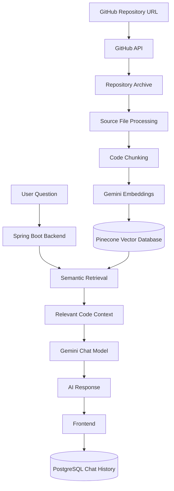
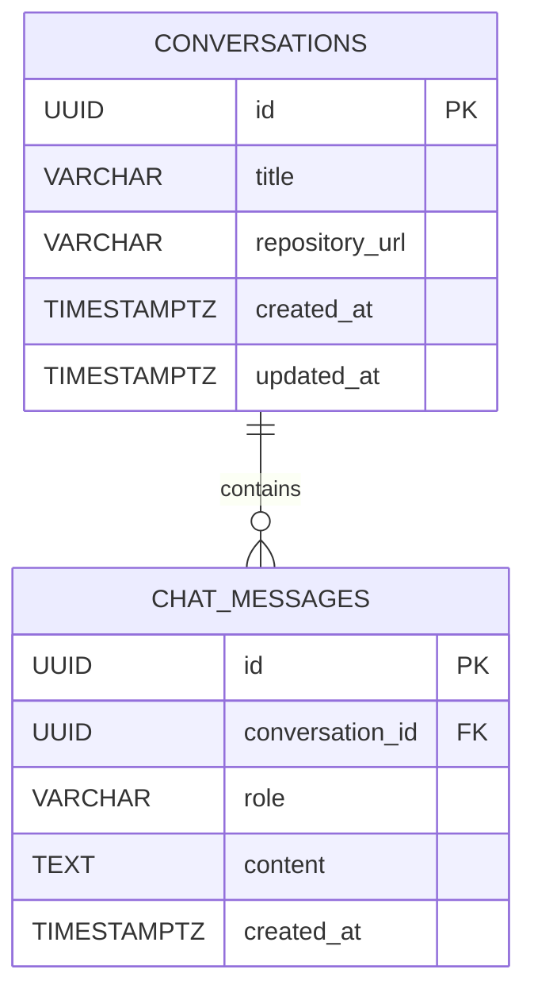

# Code Archeologist

**An AI-powered GitHub repository analysis and code intelligence platform.**

Code Archeologist helps developers understand unfamiliar codebases through natural-language questions, semantic code search, architecture analysis, and code execution-flow explanations.

Instead of manually navigating hundreds of files, developers can connect a public GitHub repository, index its source code, and use AI to explore how the project is structured and how its components work together.

Built with **Java, Spring Boot, Spring AI, Gemini, Pinecone, PostgreSQL, and vanilla JavaScript**.

---

## Table of Contents

- [Overview](#overview)
- [Features](#features)
- [How It Works](#how-it-works)
- [Architecture](#architecture)
- [Technology Stack](#technology-stack)
- [Getting Started](#getting-started)
- [Environment Configuration](#environment-configuration)
- [Running the Application](#running-the-application)
- [API Reference](#api-reference)
- [Database Design](#database-design)
- [Project Structure](#project-structure)
- [Troubleshooting](#troubleshooting)
- [Current Scope and Limitations](#current-scope-and-limitations)

---

## Overview

Understanding an unfamiliar software repository can be time-consuming. Developers often need to inspect multiple files, trace dependencies, identify entry points, and understand how different components interact.

Code Archeologist addresses this problem using **Retrieval-Augmented Generation (RAG)**.

It ingests source code from public GitHub repositories, converts the code into searchable chunks, generates vector embeddings, and stores them in Pinecone.

When a developer asks a question, the application retrieves relevant code context and uses Google's Gemini model to generate an answer grounded in the repository.

The application also provides specialized repository analysis capabilities and persistent chat history.

## Features

### 1. GitHub Repository Ingestion

- Connect a public GitHub repository using its URL.
- Retrieve repository information and its default branch.
- Download and process repository source files.
- Split source code into manageable chunks.
- Generate vector embeddings using Gemini.
- Store embeddings and associated metadata in Pinecone.
- Track the number of processed files and generated chunks.

### 2. AI-Powered Code Q&A

Ask natural-language questions about an indexed repository.

Examples:

- Explain the overall architecture of this project.
- Where is the application entry point?
- How does authentication work?
- Explain how the database connection is configured.
- Trace the flow of a particular API request.

The application retrieves relevant code context and generates an AI response with supporting source information.

### 3. Repository Architecture Analysis

Generate an AI-powered explanation of a repository's architecture.

The analysis helps developers understand the overall structure and organization of the codebase.

### 4. Code Execution Flow Analysis

Describe a particular workflow and receive an explanation of how it moves through the repository.

For example:

- Explain the login flow.
- Trace how an HTTP request reaches the database.
- Explain the order-processing workflow.

### 5. Semantic Code Search

Search indexed source code using natural-language queries rather than relying only on exact keyword matches.

The application retrieves relevant code chunks and their metadata.

### 6. Repository Status

Check whether a repository has already been indexed.

### 7. Persistent Chat History

Chat conversations are stored in PostgreSQL instead of relying exclusively on browser local storage.

Features include:

- Create conversations.
- Store user questions and AI responses.
- Retrieve previous conversations.
- Restore messages after refreshing the application.
- Delete conversations.
- Automatically generate conversation titles from the first user message.
- Associate conversations with repository URLs.

### 8. Developer-Friendly Interface

- Minimal monochrome interface.
- Chat-based interaction.
- Collapsible conversation sidebar.
- Repository connection controls.
- Dedicated analysis actions.
- Responsive layout.

---

## How It Works

Code Archeologist follows a Retrieval-Augmented Generation workflow.

### Repository Indexing

1. The user submits a public GitHub repository URL.
2. The backend communicates with the GitHub API.
3. The repository's default branch and source archive are retrieved.
4. Source files are extracted and processed.
5. `CodeChunkingService` splits source code into smaller chunks.
6. Gemini generates embeddings for the chunks.
7. Pinecone stores the vectors and associated metadata.

### Question Answering

1. The user submits a question about the repository.
2. The question is processed by the backend.
3. Relevant code chunks are retrieved from Pinecone using semantic similarity.
4. Retrieved context is provided to Gemini.
5. Gemini generates an answer based on the retrieved repository context.
6. The answer and supporting source information are returned to the frontend.
7. The conversation is persisted in PostgreSQL.

### Workflow Diagram



---

## Architecture

The application uses a layered Spring Boot architecture.

| Layer | Responsibility |
|---|---|
| Controller | Exposes REST APIs and handles HTTP requests |
| Service | Implements repository ingestion, indexing, retrieval, and analysis |
| DTO | Transfers request and response data |
| Model | Defines persistent database entities |
| Repository | Provides database access through Spring Data JPA |
| Config | Configures external AI and vector database integrations |

### Core Services

| Service | Responsibility |
|---|---|
| `GitHubRepositoryService` | Retrieves GitHub repository information |
| `GitHubContentService` | Handles repository source content retrieval |
| `RepositoryIngestionService` | Processes repository content |
| `CodeChunkingService` | Splits source code into chunks |
| `RepositoryIndexingService` | Coordinates embedding generation and vector indexing |
| `RepositoryRetrievalService` | Retrieves relevant indexed code |
| `CodeQuestionService` | Generates repository-based answers |
| `RepositoryArchitectureService` | Performs architecture analysis |
| `CodeFlowAnalysisService` | Analyzes code execution flows |
| `ConversationService` | Manages persistent conversations and messages |

---

## Technology Stack

### Backend

- Java
- Spring Boot
- Spring AI
- Spring Web
- Spring Data JPA
- Jakarta Validation
- Maven

### AI and Retrieval

- Google Gemini Chat Model
- Gemini Embedding Model
- Retrieval-Augmented Generation (RAG)
- Pinecone Vector Database
- Semantic Similarity Search

### Database

- PostgreSQL
- Hibernate
- Spring Data JPA

### Frontend

- HTML5
- CSS3
- Vanilla JavaScript
- Fetch API

### External Integrations

- GitHub REST API
- Google Gemini API
- Pinecone API

---

## Getting Started

Follow these instructions to run Code Archeologist locally.

### Prerequisites

Install the following:

- Java 21 or compatible newer JDK
- Git
- PostgreSQL
- Maven (optional, because the project includes Maven Wrapper)
- A Google Gemini API key
- A Pinecone API key

You also need a Pinecone index configured for:

| Setting | Value |
|---|---|
| Index name | `code-archeologist-vectors` |
| Dimensions | `768` |
| Metric | `cosine` |

Use a Pinecone index configuration compatible with the application's embedding model.

### 1. Clone the Repository

```bash
git clone <YOUR_GITHUB_REPOSITORY_URL>
cd code-archeologist
```

### 2. Create the PostgreSQL Database

Open PostgreSQL and execute:

```sql
CREATE DATABASE code_archeologist;
```

The application connects to PostgreSQL on:

```text
localhost:5432
```

Hibernate is configured with `ddl-auto=update`, allowing it to create or update the application's entity tables.

### 3. Configure Environment Variables

Create a `.env` file in the project root.

You can use `.env.example` as a template:

```bash
cp .env.example .env
```

On Windows PowerShell, use:

```powershell
Copy-Item .env.example .env
```

Update `.env` with your own credentials:

```properties
GOOGLE_API_KEY=your_gemini_api_key
PINECONE_API_KEY=your_pinecone_api_key

POSTGRES_DB=code_archeologist
POSTGRES_USER=postgres
POSTGRES_PASSWORD=your_postgresql_password
```

**Important:** Never commit `.env` or expose API keys and database passwords publicly.

### 4. Verify Configuration

The main configuration is located in:

```text
src/main/resources/application.properties
```

The application uses:

- Gemini Chat: `gemini-3.6-flash`
- Gemini Embeddings: `gemini-embedding-2`
- Embedding Dimensions: `768`
- Pinecone Index: `code-archeologist-vectors`
- PostgreSQL Database: `code_archeologist`

### 5. Build the Application

On Windows:

```powershell
.\mvnw.cmd clean compile
```

On Linux/macOS:

```bash
./mvnw clean compile
```

### 6. Run the Application

On Windows:

```powershell
.\mvnw.cmd spring-boot:run
```

On Linux/macOS:

```bash
./mvnw spring-boot:run
```

The backend starts at:

```text
http://localhost:8080
```

Open the application in your browser:

```text
http://localhost:8080
```

---

## API Reference

Base URL:

```text
http://localhost:8080
```

### Repository APIs

| Method | Endpoint | Description |
|---|---|---|
| POST | `/api/repositories/ingest` | Ingest and index a GitHub repository |
| GET | `/api/repositories/status` | Check repository indexing status |
| GET | `/api/repositories/search` | Search indexed source code |
| POST | `/api/repositories/ask` | Ask questions about repository code |
| POST | `/api/repositories/architecture` | Analyze repository architecture |
| POST | `/api/repositories/flow` | Analyze a code execution flow |

### Ingest Repository

**POST** `/api/repositories/ingest`

Request:

```json
{
  "repositoryUrl": "https://github.com/spring-projects/spring-petclinic"
}
```

Response:

```json
{
  "message": "Repository successfully indexed in Pinecone!",
  "totalFiles": 120,
  "totalChunks": 450
}
```

The file and chunk counts above are illustrative; actual values depend on the repository.

### Check Repository Status

**GET** `/api/repositories/status`

Query parameter:

```text
repositoryUrl=https://github.com/spring-projects/spring-petclinic
```

Example:

```text
GET /api/repositories/status?repositoryUrl=https://github.com/spring-projects/spring-petclinic
```

### Search Repository

**GET** `/api/repositories/search`

Query parameter:

```text
question=Where is the application entry point?
```

Example:

```text
GET /api/repositories/search?question=Where%20is%20the%20application%20entry%20point
```

Returns relevant code content and metadata.

### Ask a Question

**POST** `/api/repositories/ask`

Request:

```json
{
  "repositoryUrl": "https://github.com/spring-projects/spring-petclinic",
  "question": "Explain the overall architecture of this project."
}
```

The response contains the generated answer and supporting source information.

### Analyze Architecture

**POST** `/api/repositories/architecture`

Request:

```json
{
  "repositoryUrl": "https://github.com/spring-projects/spring-petclinic"
}
```

Response:

```json
{
  "architecture": "Architecture analysis generated by the AI model."
}
```

### Analyze Code Flow

**POST** `/api/repositories/flow`

Request:

```json
{
  "repositoryUrl": "https://github.com/spring-projects/spring-petclinic",
  "flowDescription": "Explain the user login flow."
}
```

Response:

```json
{
  "flowAnalysis": "Code flow analysis generated by the AI model."
}
```

---

### Conversation APIs

Base endpoint:

```text
/api/conversations
```

| Method | Endpoint | Description |
|---|---|---|
| POST | `/api/conversations` | Create a conversation |
| GET | `/api/conversations` | Retrieve all conversations |
| GET | `/api/conversations/{id}` | Retrieve a conversation and its messages |
| POST | `/api/conversations/{id}/messages` | Save a conversation message |
| DELETE | `/api/conversations/{id}` | Delete a conversation and its messages |

### Create Conversation

**POST** `/api/conversations`

Request:

```json
{
  "repositoryUrl": "https://github.com/spring-projects/spring-petclinic"
}
```

### Save Message

**POST** `/api/conversations/{id}/messages`

Request:

```json
{
  "role": "user",
  "content": "Explain the main architecture of this repository."
}
```

Supported roles:

- `user`
- `assistant`

### Retrieve Conversations

**GET** `/api/conversations`

Returns the available conversation summaries.

### Retrieve Conversation Details

**GET** `/api/conversations/{id}`

Returns the conversation and its associated messages.

### Delete Conversation

**DELETE** `/api/conversations/{id}`

Deletes the conversation and its associated messages.

---

### Diagnostic APIs

| Method | Endpoint | Description |
|---|---|---|
| GET | `/api/test/gemini` | Test Gemini connectivity |
| GET | `/api/test/embedding` | Test embedding generation |
| GET | `/api/test/pinecone` | Test Pinecone connectivity |

---

## Database Design

PostgreSQL is used to persist conversation history.

### Conversations

Stores conversation-level information.

| Column | Type | Description |
|---|---|---|
| `id` | UUID | Primary key |
| `title` | VARCHAR | Conversation title |
| `repository_url` | VARCHAR | Associated repository URL |
| `created_at` | TIMESTAMPTZ | Creation timestamp |
| `updated_at` | TIMESTAMPTZ | Last update timestamp |

### Chat Messages

Stores individual messages belonging to conversations.

| Column | Type | Description |
|---|---|---|
| `id` | UUID | Primary key |
| `conversation_id` | UUID | Associated conversation |
| `role` | VARCHAR | `user` or `assistant` |
| `content` | TEXT | Message content |
| `created_at` | TIMESTAMPTZ | Message timestamp |

### Relationship

One conversation can contain multiple messages.



Pinecone separately stores the vector representations and metadata used for code retrieval.

---

## Project Structure

```text
code-archeologist/
│
├── src/
│   └── main/
│       ├── java/com/codearcheologist/
│       │   │
│       │   ├── config/
│       │   │   ├── GeminiConfig.java
│       │   │   ├── PineconeConfig.java
│       │   │   └── RestClientConfig.java
│       │   │
│       │   ├── controller/
│       │   │   ├── CodeFlowAnalysisController.java
│       │   │   ├── CodeQuestionController.java
│       │   │   ├── ConversationController.java
│       │   │   ├── RepositoryArchitectureController.java
│       │   │   ├── RepositoryController.java
│       │   │   ├── RepositorySearchController.java
│       │   │   └── RepositoryStatusController.java
│       │   │
│       │   ├── dto/
│       │   │
│       │   ├── model/
│       │   │   ├── ChatMessage.java
│       │   │   └── Conversation.java
│       │   │
│       │   ├── repository/
│       │   │   ├── ChatMessageRepository.java
│       │   │   └── ConversationRepository.java
│       │   │
│       │   ├── service/
│       │   │   ├── CodeChunkingService.java
│       │   │   ├── CodeFlowAnalysisService.java
│       │   │   ├── CodeQuestionService.java
│       │   │   ├── ConversationService.java
│       │   │   ├── GitHubContentService.java
│       │   │   ├── GitHubRepositoryService.java
│       │   │   ├── RepositoryArchitectureService.java
│       │   │   ├── RepositoryIndexingService.java
│       │   │   ├── RepositoryIngestionService.java
│       │   │   └── RepositoryRetrievalService.java
│       │   │
│       │   └── CodeArcheologistApplication.java
│       │
│       └── resources/
│           ├── static/
│           │   ├── index.html
│           │   ├── script.js
│           │   └── style.css
│           │
│           └── application.properties
│
├── .env.example
├── .gitignore
├── mvnw
├── mvnw.cmd
├── pom.xml
└── README.md
```

---

## Troubleshooting

### Application cannot connect to PostgreSQL

Verify that:

- PostgreSQL is running.
- The `code_archeologist` database exists.
- The database username and password in `.env` are correct.
- PostgreSQL is listening on port `5432`.

### Gemini API errors

Verify:

- `GOOGLE_API_KEY` is configured correctly.
- The API key has access to the configured Gemini models.
- The configured model names are available to your API account.

### Pinecone connection errors

Verify:

- `PINECONE_API_KEY` is correct.
- The index name matches `code-archeologist-vectors`.
- The index uses 768 dimensions and cosine similarity.
- The Pinecone index is available.

### Repository ingestion returns 404

Check that:

- The GitHub URL is correct.
- The repository exists.
- The repository is public.
- The repository URL follows the expected GitHub format.

### Conversation history does not appear

Verify:

- PostgreSQL is running.
- The application has successfully initialized JPA.
- The browser can access the `/api/conversations` endpoints.
- The browser console and Spring Boot logs do not show errors.

---

## Current Scope and Limitations

- Designed for public GitHub repositories.
- Requires valid Gemini and Pinecone credentials.
- Repository indexing must be completed before repository-based retrieval can work.
- AI-generated explanations should be verified against the actual source code.
- PostgreSQL stores conversations and messages; Pinecone stores searchable code vectors.
- The current application is intended for local development and experimentation.
- Authentication and multi-user authorization are not currently implemented.

---

## Future Improvements

Potential directions for extending the project:

- Support private GitHub repositories with secure authorization.
- Add incremental indexing for repository changes.
- Improve language-aware code chunking.
- Add dependency graphs and visual architecture exploration.
- Add more advanced cross-file code tracing.
- Introduce user authentication and isolated workspaces.
- Add automated evaluation of retrieval quality and generated answers.

---

## Author

**Om Shankhpal**

Java Backend Engineer | MERN Stack Developer

- GitHub: [om-shankhpal](https://github.com/om-shankhpal)
- LinkedIn: [Om Shankhpal](https://www.linkedin.com/in/om-shankhpal-089822320/)

---

*Code Archeologist — Explore repositories. Understand code. Trace execution.*
